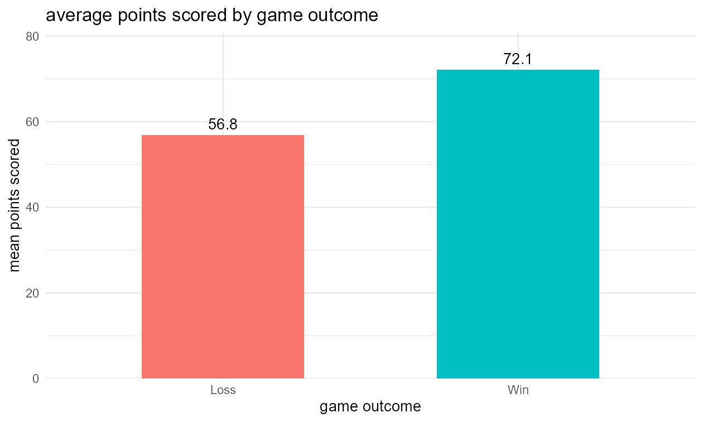
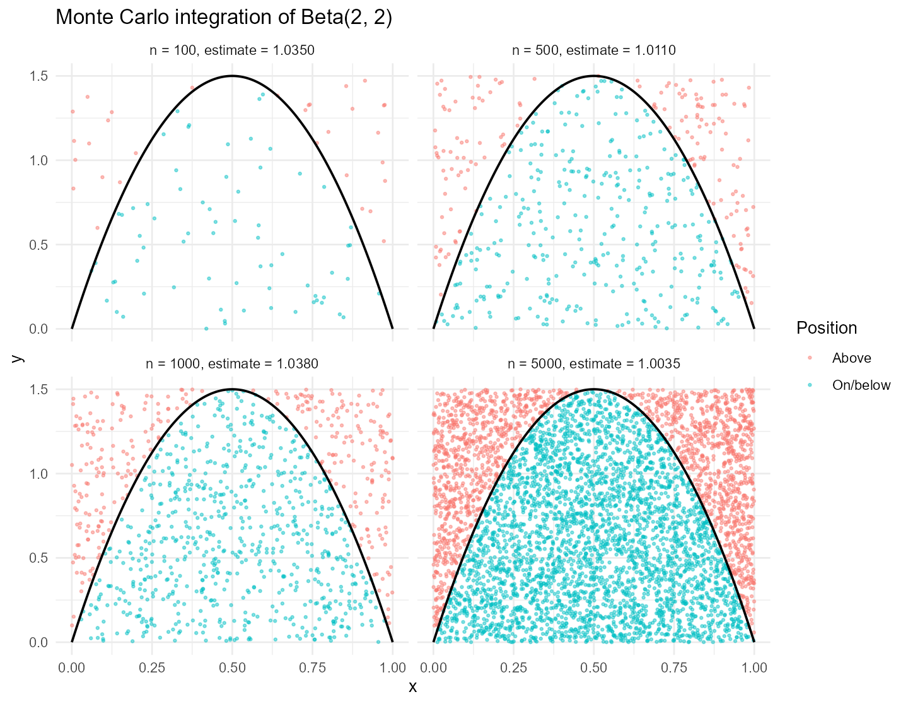
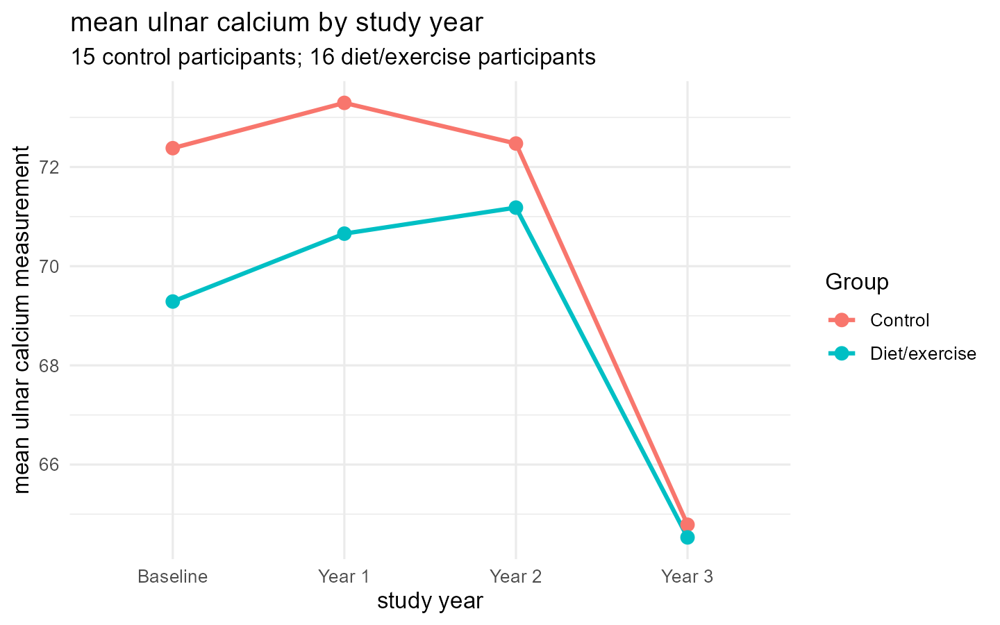

```{r}
#| include: false
library(tidyverse)
library(knitr)

# Valid diamond dimensions only; physical dimensions x, y, z measured in mm.
diamond_data <- ggplot2::diamonds |>
  filter(x > 0, y > 0, z > 0)

# Summarize a physical dimension within each cut grade.
dimension_summary <- function(variable) {
  diamond_data |>
    group_by(cut) |>
    summarise(
      Count = n(), Min = min(.data[[variable]]),
      `20%` = quantile(.data[[variable]], .20),
      `40%` = quantile(.data[[variable]], .40),
      Median = median(.data[[variable]]),
      `60%` = quantile(.data[[variable]], .60),
      `80%` = quantile(.data[[variable]], .80),
      Max = max(.data[[variable]]),
      Mean = mean(.data[[variable]]), SD = sd(.data[[variable]]),
      .groups = "drop"
    )
}
length_stats <- dimension_summary("x")
width_stats  <- dimension_summary("y")
depth_stats  <- dimension_summary("z")

# Emit a Markdown table with one caption/label, avoiding duplicate Typst IDs.
show_table <- function(data, caption, reference) {
  cat(knitr::kable(data, format = "pipe", digits = 4), sep = "\n")
  cat("\n\n: ", caption, " {#", reference, "}\n\n", sep = "")
}
```

# Diamonds Descriptive Statistics

For this section, I used the `diamonds` dataset to compare diamond length (`x`), width (`y`), and height or depth (`z`) across the five cut qualities. All three measurements are in millimeters. I removed diamonds with a value of zero for any of these dimensions because a zero measurement would not make sense for an actual diamond. The tables show the number of diamonds, the minimum and maximum, the mean, median, standard deviation, and the 20%, 40%, 60%, and 80% quintiles. These statistics help show both the typical size of diamonds in each group and how much the measurements vary.

## Diamond Length

```{r}
#| results: asis
show_table(length_stats,
           "Diamond length (mm) by cut quality",
           "tbl-diamond-length")
```

One thing that stands out in @tbl-diamond-length is that the Fair group has the highest average length at 6.25mm, while the Ideal group has the lowest at 5.51mm. This is interesting because Ideal is the highest cut grade, but those diamonds are not the longest on average. I would not take this to mean that lower-quality cuts produce larger diamonds, since cut quality and size are different things. The medians and quintiles also show that lengths vary quite a bit within each group, rather than every diamond being close to its group's average.

## Diamond Width

```{r}
#| results: asis
show_table(width_stats,
           "Diamond width (mm) by cut quality",
           "tbl-diamond-width")
```

The width results in @tbl-diamond-width follow a similar pattern to the length results. Fair diamonds have the highest mean width at 6.19mm, while Ideal diamonds are lower on average. However, the most noticeable numbers to me are the maximum widths of 58.90 mm for Premium and 31.80 mm for Ideal. Those are much higher than the typical widths shown by the means and medians. I would want to check those observations before putting too much weight on the maximum values. The medians seem more useful for understanding what a typical diamond in each cut group looks like.

## Diamond Depth

```{r}
#| results: asis
show_table(depth_stats,
           "Diamond height or depth (mm) by cut quality",
           "tbl-diamond-depth")
```

The depth table shows that Fair diamonds also have the highest mean depth, at 3.99 mm, compared with 3.40 mm for Ideal diamonds. This makes the overall pattern more consistent across the three dimensions, although it still does not explain why the groups differ. For example, the Very Good group has a maximum depth of 31.80 mm, which is far above its mean of 3.56 mm. I think checking unusual measurements and accounting for carat weight would be important before making stronger claims about how cut quality relates to diamond dimensions.

# Big 10 Academic Alliance–Love Data Week

## Research Question and Data Preparation

For the Big 10 Academic Alliance Love Data Week project, I examined scoring differences between winning and losing teams in women's college basketball.

The main research question was:
  
  **How does the average number of points scored differ between winning and losing team performances?**
  
  The original dataset contains information about individual basketball games, including the home team, away team, and final scores.

To answer this question, I first removed games that were incomplete, missing scores, or recorded as ties.

Next, I reorganized the data so that each game contributed two observations: one for the home team and one for the away team.

Each observation contains the team name, opponent, points scored, and game result.

This organization makes it possible to compare winning and losing performances without restricting the analysis to home or away teams.

```{r}
#| include: false
# Read only the columns required for the research question.
games <- readr::read_csv(unz("games(csv).zip", "games.csv"),
                         show_col_types = FALSE) |>
  select(id, game_date, season, status_type_completed,
         home_display_name, away_display_name, home_score, away_score)
valid_games <- games |>
  filter(status_type_completed == TRUE,
         !is.na(home_score), !is.na(away_score),
         home_score != away_score)
home_rows <- valid_games |>
  transmute(id, season, game_date, team = home_display_name,
            opponent = away_display_name, points = home_score,
            outcome = if_else(home_score > away_score, "Win", "Loss"))
away_rows <- valid_games |>
  transmute(id, season, game_date, team = away_display_name,
            opponent = home_display_name, points = away_score,
            outcome = if_else(away_score > home_score, "Win", "Loss"))
team_games <- bind_rows(home_rows, away_rows) |>
  filter(!is.na(team), !is.na(opponent))
scoring_summary <- team_games |>
  group_by(outcome) |>
  summarise(games = n(), mean_points = mean(points), .groups = "drop") |>
  mutate(outcome = factor(outcome, levels = c("Loss", "Win")))

# Save a reproducible image to be placed and labeled exactly once.
p_btaa <- ggplot(scoring_summary,
                 aes(x = outcome, y = mean_points, fill = outcome)) +
  geom_col(width = .55, show.legend = FALSE) +
  geom_text(aes(label = round(mean_points, 1)), vjust = -.5) +
  scale_y_continuous(limits = c(0, NA),
                     expand = expansion(mult = c(0, .12))) +
  labs(title = "average points scored by game outcome",
       x = "game outcome", y = "mean points scored") +
  theme_minimal()
ggsave("btaa-scoring.png", p_btaa, width = 7, height = 4.2, dpi = 180)
```

## Scoring Visualization and Interpretation

{#fig-btaa-scoring}

@fig-btaa-scoring compares the average number of points scored in winning and losing performances.

Winning teams averaged approximately 72.14 points, while losing teams averaged approximately 56.84 points. This represents a difference of about 15.30 points.

Although winning performances have higher average scores, this comparison should not be interpreted as identifying the causes of winning.

A winning team must outscore its opponent, so the observed difference is expected. The more informative aspect of the analysis is the size of the average scoring difference across the collected games.

The visualization also demonstrates the value of properly preparing data before analysis. By reorganizing the original home and away information, I was able to make comparisons at the team-performance level rather than treating home and away teams separately.

One limitation is that averaging games across teams and seasons can hide differences in team strength, pace of play, and other game characteristics.

# Monte Carlo Numerical Integration

## Method

For the Monte Carlo simulation, my assigned function was the Beta(2, 2) probability density function:

$$
f(x) = 6x(1-x)
$$

I used the following boundaries for the simulation:

$$
0 \leq x \leq 1
$$

$$
0 \leq y \leq 1.5
$$

The rectangle has an area of 1.5. The simulation generates random points within these boundaries and checks whether each point is on or below the curve or above it. The proportion that falls below the curve can then be used to estimate the area under the function.

I calculated the estimated area using:

$$
\widehat{I} = 1.5 \times
\frac{\text{Number of points on or below the curve}}
{\text{Total number of points}}
$$

Since this is a probability density function, the exact area under the curve is 1. We can also confirm that by integrating:

$$
\int_0^1 6x(1-x)\,dx = 1
$$

I used a fixed random seed so that running the code again produces the same random points and estimates.

```{r}
#| include: false
# Return a data frame containing uniformly generated coordinates.
monte_carlo <- function(n, x_min, x_max, y_min, y_max) {
  tibble(x = runif(n, x_min, x_max),
         y = runif(n, y_min, y_max))
}
set.seed(184)
sizes <- c(100, 500, 1000, 5000)
mc_points <- purrr::map_dfr(sizes, function(n) {
  monte_carlo(n, 0, 1, 0, 1.5) |>
    mutate(curve = dbeta(x, 2, 2),
           position = if_else(y <= curve, "On/below", "Above"),
           sample_size = n)
})
mc_results <- mc_points |>
  group_by(sample_size) |>
  summarise(estimate = 1.5 * mean(position == "On/below"),
            .groups = "drop") |>
  mutate(abs_error = abs(estimate - 1),
         panel = paste0("n = ", sample_size,
                        ", estimate = ", sprintf("%.4f", estimate)))
mc_points <- mc_points |>
  left_join(select(mc_results, sample_size, panel), by = "sample_size") |>
  mutate(panel = factor(panel, levels = mc_results$panel))
curve_data <- tibble(x = seq(0, 1, length.out = 301),
                     y = dbeta(x, 2, 2))
p_mc <- ggplot(mc_points, aes(x, y, color = position)) +
  geom_point(alpha = .45, size = .6) +
  geom_line(data = curve_data, aes(x, y), inherit.aes = FALSE,
            color = "black", linewidth = .7) +
  facet_wrap(~panel, ncol = 2) +
  coord_cartesian(xlim = c(0, 1), ylim = c(0, 1.5)) +
  labs(x = "x", y = "y", color = "Position",
       title = "Monte Carlo integration of Beta(2, 2)") +
  theme_minimal()
ggsave("monte-carlo.png", p_mc, width = 8, height = 6.2, dpi = 180)
```

## Four-Panel Visualization

{#fig-monte-carlo}

```{r}
#| results: asis
show_table(
  mc_results |>
    transmute(`Sample size` = sample_size,
              Estimate = round(estimate, 4),
              `Absolute error` = round(abs_error, 4)),
  "Monte Carlo estimates compared with the exact integral of one",
  "tbl-monte-results"
)
```

## Interpretation

From the graphs in @fig-monte-carlo, we can see how Monte Carlo simulation uses random points to estimate the area under a function. I believe the exact value of the integral is 1, since this is a probability density function and the total area underneath it must equal 1. This also matches the integral shown above.

The estimates from my four graphs are 1.0350, 1.0110, 1.0380, and 1.0035, as shown in @tbl-monte-results. All four are relatively close to 1. As the number of points increases, the estimates generally become more accurate, although the 1,000-point estimate is farther from 1 than the 500-point estimate. This shows that using more points generally improves the reliability of Monte Carlo integration, but randomness can still cause some differences between estimates. Overall, the graphs help show how increasing the number of points provides a better approximation of the area underneath the curve.

# Planning and Prompting GenAI

## Calcium Data Context and Goal

For this part, I used the `calcium.csv` data to compare calcium measurements over time for two groups of women. The study itself includes 31 women. 15 in the control group who kept their usual lifestyles and 16 in the diet/exercise group who received dietary support and followed an exercise program. The first four columns belong to the control group, and the next four belong to the diet/exercise group, y0 is the starting measurement, followed by Years 1, 2, and 3. The file doesn't exactly contain measurement units.

My main question was: How did the average calcium measurements change from the beginning of the study through Year 3, and did the two groups change in different ways? I wanted the graph to show these differences clearly not assuming that the diet/exercise program caused them.

## Visualization Plan

**Goal.** Compare the average calcium measurements over the four time points for both groups while keeping the groups and their different sample sizes separate.

**Nouns.** Calcium data file, control group, diet/exercise group, 31 participants, participant ID, baseline and Years 1–3 (`y0` through `y3`), numeric ulnar calcium measurement, missing value, long-format dataset, group-specific average, line graph, points, axis labels, legend, and caption.

**Verbs.** Import, inspect, verify, assign, reshape, filter, group, calculate, compare, plot, label, and interpret.

**Plan of work.**

1. Load `calcium.csv` without automatically changing its duplicate column headers; verify that there are eight columns, organized as two four-measurement blocks.
2. Check the variable types and the missing observations. The control-group block has one completely empty final record because the two side-by-side groups have different sample sizes (15 versus 16); this row must not become an extra person.
3. Give each row a participant ID within its group, and rename the four measurement positions consistently as `y0`, `y1`, `y2`, and `y3`.
4. Reshape the two groups from wide to long format, retaining the participant IDs so that repeated observations remain linked.
5. Summarize each group and measurement occasion using its sample size and mean. Calculate the average change between occasions 0 and 3 for each group.
6. Create a line plot showing the four time-specific group means, with separate lines/colors for control and diet/exercise, labeled baseline and Years 1–3, an informative caption, and alternative text.
7. Check whether trends in the graph agree with the numeric summaries and discuss the limits of interpretation due to the small sample sizes, unknown units, and unverified random assignment.

## Plan-Informed ChatGPT Prompt

The prompt below was written using the plan above and the original `calcium.csv` file. I wanted a graph that compares the groups over time rather than putting all eight columns into one sequence.

> Using the attached, unchanged `calcium.csv`, create reproducible R code for a professional visualization of ulnar calcium measurements in a four-year longitudinal study. The first four columns `y0`–`y3` are the 15 control participants and the second four columns `y0`–`y3` are the 16 diet/exercise participants. Measurements are at baseline and Years 1, 2, and 3. First inspect the duplicate headers, missing values, and data types. Preserve each participant's repeated measurements while reshaping the data into tidy long format. Calculate sample size and mean at each time point within each group and the mean paired change from baseline to Year 3. Create a clear line graph comparing both group means over time, with appropriate axis labels, legend, caption, and alt text. Give executable, commented R code, a brief interpretation, and relevant limitations. Do not modify the original CSV, invent units, or claim causality.

## Data Preparation and Summary

```{r}
#| include: false
# Read the file by position: its two blocks use identical column names.
calcium_raw <- readr::read_csv(
  "calcium.csv", skip = 1, col_names = FALSE,
  show_col_types = FALSE
)
stopifnot(ncol(calcium_raw) == 8L)

# Preserve the pairing within each four-column group.
calcium_A <- calcium_raw |>
  transmute(person = row_number(), group = "Control",
            y0 = X1, y1 = X2, y2 = X3, y3 = X4)
calcium_B <- calcium_raw |>
  transmute(person = row_number(), group = "Diet/exercise",
            y0 = X5, y1 = X6, y2 = X7, y3 = X8)
calcium_wide <- bind_rows(calcium_A, calcium_B) |>
  filter(!if_all(c(y0, y1, y2, y3), is.na))

calcium_long <- calcium_wide |>
  pivot_longer(cols = c(y0, y1, y2, y3),
               names_to = "occasion", values_to = "measurement") |>
  filter(!is.na(measurement)) |>
  mutate(occasion = factor(occasion, levels = c("y0", "y1", "y2", "y3"),
                           labels = c("Baseline", "Year 1", "Year 2", "Year 3")))

calcium_summary <- calcium_long |>
  group_by(group, occasion) |>
  summarise(n = n(), average = mean(measurement),
            sd = sd(measurement), .groups = "drop")

calcium_changes <- calcium_wide |>
  mutate(change = y3 - y0) |>
  group_by(group) |>
  summarise(n = sum(!is.na(change)), mean_change = mean(change, na.rm = TRUE),
            .groups = "drop")

# Save the plan-based plot as an image with one caption and reference.
p_calcium_plan <- ggplot(calcium_summary,
                         aes(x = occasion, y = average,
                             group = group, color = group)) +
  geom_line(linewidth = 1.05) +
  geom_point(size = 2.8) +
  labs(title = "mean ulnar calcium by study year",
       subtitle = "15 control participants; 16 diet/exercise participants",
       x = "study year", y = "mean ulnar calcium measurement", color = "Group") +
  theme_minimal(base_size = 12)
ggsave("calcium-plan.png", p_calcium_plan,
       width = 7.2, height = 4.5, dpi = 200)


```

```{r}
#| results: asis
show_table(
  calcium_summary |>
    mutate(Average = round(average, 2), `Standard deviation` = round(sd, 2)) |>
    select(Group = group, Occasion = occasion, `Sample size` = n,
           Average, `Standard deviation`),
  "Recorded measurements across occasions, by original column group",
  "tbl-calcium-means"
)
```

The averages in @tbl-calcium-means are relatively steady through Year 2 for both groups, followed by a larger decrease in Year 3. For example, the control group goes from **72.38** at baseline to **73.29** in Year 1 and **72.47** in Year 2 before falling to **64.79**. The diet/exercise group follows a similar pattern. The sample sizes are also important here: there are **`r calcium_changes$n[calcium_changes$group == "Control"]`** control participants and **`r calcium_changes$n[calcium_changes$group == "Diet/exercise"]`** diet/exercise participants with complete baseline and Year 3 measurements. I excluded the blank control row so it would not affect these averages.

## Plan-Based Visualization

{#fig-calcium-plan}

What stands out most in @fig-calcium-plan is that the two groups do not start at the same average. The control group begins higher, but by Year 3 the averages are almost the same. Looking at the changes from each group's own baseline, the control group decreases by **`r sprintf("%.2f", calcium_changes$mean_change[calcium_changes$group == "Control"])`**, compared with **`r sprintf("%.2f", calcium_changes$mean_change[calcium_changes$group == "Diet/exercise"])`** for the diet/exercise group. The smaller decline in the diet/exercise group could point to a possible benefit, but the graph alone cannot tell us whether the program caused the difference. I would need more information about how the groups were assigned and a statistical comparison before reaching that conclusion.

## Generic-Prompt Results and Comparison

The instructor's generic ChatGPT graph was created using **ChatGPT (GPT-5.3)** on March 31, 2026, with the prompt *"Create a data visualization for these data. Calcium.csv"*. This prompt did not explain that the columns came from two different groups or that the measurements were taken over four years.

{#fig-calcium-generic width=85%}

The biggest issue I noticed in @fig-calcium-generic is not the numbers themselves, but the way the graph connects them. The first four averages belong to the control group and the next four belong to the diet/exercise group, yet the single line makes them look like one continuous set of measurements. In particular, the line from the control group's Year 3 result to the diet/exercise group's baseline does not represent a change over time at all. Without knowing the structure of the file, it would be easy to misread that part of the graph.

In comparison, @fig-calcium-plan lets us follow each group from baseline through Year 3 without mixing their measurements together. It also shows something the generic graph makes harder to notice: the groups start at different levels but end up with very similar averages. The control group's decline of about **7.59** is larger than the diet/exercise group's decline of about **4.76**. To me, this is why the planning step mattered. Explaining the groups and time points changed the graph from a basic column summary into a comparison that actually addresses the study question.

Both graphs are based on the same measurements, but they communicate different things. The generic graph is useful for a quick look at the eight column averages, while the planned graph is better for comparing the two groups over time. Neither graph by itself proves that the diet/exercise program caused the observed differences.

# Reflection Section

A lesson I learned during the diamonds work was that a single average can conceal important features of a distribution. At first I focused on whether one cut category had a larger mean dimension. Calculating quintiles and standard deviations showed me that the spread of observations also matters; unusually large maximum dimensions can make a mean less representative. In a future analysis, I would check extreme observations before interpreting the group comparisons.

The BTAA project changed how I think about the structure of a dataset. Games initially appeared as one row with separate home and away score columns, which was inconvenient for the question I wanted to ask. Reshaping them into two team-performance observations per game allowed me to compare winning and losing scores consistently. I also learned to be careful about interpretation: saying that winners have higher scores does not explain *why* teams win.

Monte Carlo integration was useful because I could test a simulation against a known mathematical answer. I expected the estimate to improve each time I increased the number of points, but random fluctuations showed me why an individual run can be farther from the correct answer even at a larger sample size. I now distinguish overall precision from the error in one particular simulation.

Finally, working with repeated measurements in the calcium file reinforced why data checking belongs in the planning stage. The repeated column names and one empty control-group row could have made a quick graph misleading. I improved at thinking through the unit of observation, keeping repeated records linked, and matching a visual display to a specific question. Quarto brought these lessons together by requiring a reproducible analysis with enough narrative, references, and code documentation for a reader to follow my work.

# GenAI Usage Appendix

## Tool and Version

This document was developed with assistance from **ChatGPT (GPT-6)** on **November 18–19, 2026**. ChatGPT was used to assist with interpreting results, improving narrative clarity, reviewing assignment requirements, troubleshooting Quarto formatting and rendering errors, and developing and correcting R code. The final document was reviewed and rendered in RStudio. The generic ChatGPT visualization used for comparison was provided by the instructor.


## ChatGPT Prompts

The following prompts document my use of ChatGPT (GPT-6) on November 18–19, 2026, for troubleshooting R code, resolving Quarto rendering issues, and checking document formatting.


**Previous conversation exchanges**

### Calcium CSV Error

**Prompt:**

> Error in readr::read_csv("calcium.csv", skip = 1, col_names = FALSE, show_coltypes = FALSE) : 
> unused argument (show_coltypes = FALSE)

**ChatGPT Response:**

> The error is caused by a typo in the argument name.
>
> Change:
>
> ```r
> show_coltypes = FALSE
> ```
>
> to:
>
> ```r
> show_col_types = FALSE
> ```
>
> Your corrected code should be:
>
> ```r
> calcium_raw <- readr::read_csv(
>   "calcium.csv",
>   skip = 1,
>   col_names = FALSE,
>   show_col_types = FALSE
> )
> ```
>
> **The missing underscore between `col` and `types` caused the error.**
>
> Save your `.qmd` file and click **Render** again.

### Reusing Data Wrangling from HW 3.4

**Prompt:**

> can i reuse my code from 3.4 in this assignment? would it still be relevant, mainly the visualization and data wrangling

**ChatGPT Response:**

> Yes, **you can reuse the data wrangling approach from HW #3.4 for HW #4.3**, particularly for your BTAA visualization. However, you need to make sure the code still matches the dataset and the goal of your current analysis.
>
> In HW #3.4, you worked on preparing the basketball data by selecting relevant variables, filtering observations, and restructuring the data to produce your visualization. Those same steps are appropriate for HW #4.3 because you're continuing the earlier project rather than starting a completely different analysis.
>
> The main things I would check are:
>
> 1. **Data filtering:** Make sure you're still excluding incomplete games and missing scores.
> 2. **Data restructuring:** Keep the transformation from home/away records into individual team performances so you can compare wins and losses.
> 3. **Variable names:** Confirm that the columns referenced in your code, such as `home_score` and `away_score`, exist in the current dataset.
> 4. **Reproducibility:** Your Quarto document should execute the wrangling steps directly from `games.csv`, rather than relying on objects you previously created in RStudio.
>
> For the calcium analysis, though, you'll need different wrangling code because you're working with repeated measurements from two groups of participants, not basketball game results.
>
> **My recommendation:** Keep your original HW #3.4 wrangling logic for the BTAA section, making only the changes necessary for it to run correctly in Quarto. For the calcium section, use the separate `pivot_longer()` approach you've already developed.
>
> This will help keep your code consistent with your previous assignment while satisfying the reproducibility requirements of HW #4.3.


### Local Files and Quarto Rendering

**Prompt:**

> when formatting this does using the local files cause any issues rendering could that be the cause for some of the rending issues

**ChatGPT Response:**

> Yes, **using local files can cause Quarto rendering errors**, but only under certain circumstances. Based on the errors you've encountered, some could be related to local files, while others were caused by R code or document formatting.
>
>
> **How local files can affect rendering**

>When you render your `.qmd`, Quarto needs to locate every external file referenced in your document, including `games.csv`, `calcium.csv`, and your PNG images.

>For example:

>```r
>games <- readr::read_csv("games.csv")
>```
>
>This works if `games.csv` is in the directory R is reading from. If the file is somewhere else, Quarto may produce an error such as:
>
>```text
>Error: 'games.csv' does not exist in current working directory
>```
>
>This also applies to image references such as:
>
>```markdown
>
>```
>
>If the image cannot be found, Quarto may fail to include it or report a missing-file error.
>
>
> Were your previous rendering errors caused by this?
>
>| Error | Likely cause |
>|---|---|
>| No TeX installation detected | LaTeX was not installed, unrelated to local files |
>| `could not find function "kable"` | Missing package or namespace |
>| Duplicate table/figure labels | Repeated Quarto cross-reference identifiers |
>| `show_coltypes = FALSE` unused argument | Incorrect argument spelling |
>| `game_date` not found | Column missing from the data being processed |
>| Image or CSV not found | Local file path or working-directory issue |

>Therefore, **local files can cause errors, but they were not the main cause of the specific errors we've discussed.**

> How I would organize your files

>Keep everything in the same project folder:

>```text
>STAT184_HW4_3/
>├── homework.qmd
>├── games.csv
>├── calcium.csv
>├── chatgptPlot.png
>├── btaa-scoring.png
>├── monte-carlo.png
>└── calcium-plan.png
>```

>The last three PNGs can be generated by your R code when Quarto renders.


### Calcium Data Wrangling Code

**Prompt:**

> is my code here proper? im not sure if there is a better way t odo this as to me this seems the best possible way but i am trying to cut down on code lines a bit here 

> ```r
> calcium_A <- calcium_raw |>
>   mutate(person = row_number(), group = "Control",
>             y0 = X1, y1 = X2, y2 = X3, y3 = X4)
> calcium_B <- calcium_raw |>
>   mutate(person = row_number(), group = "Diet/exercise",
>             y0 = X5, y1 = X6, y2 = X7, y3 = X8)
> calcium_wide <- bind_rows(calcium_A, calcium_B) |>
>   filter(!if_all(c(y0, y1, y2, y3), is.na))
>
> calcium_long <- calcium_wide |>
>   pivot_longer(cols = c(y0, y1, y2, y3),
>                names_to = "occasion", values_to = "measurement") |>
>   filter(!is.na(measurement)) |>
>   mutate(occasion = factor(occasion, levels = c("y0", "y1", "y2", "y3"),
>                            labels = c("Baseline", "Year 1", "Year 2", "Year 3")))
>
> calcium_summary <- calcium_long |>
>   group_by(group, occasion) |>
>   summarise(n = n(), average = mean(measurement),
>             sd = sd(measurement), .groups = "drop")
>
> calcium_changes <- calcium_wide |>
>   mutate(change = y3 - y0) |>
>   group_by(group) |>
>   summarise(n = sum(!is.na(change)), mean_change = mean(change, na.rm = TRUE),
>             .groups = "drop")
> ```
**ChatGPT Response:**

> Your code is mostly correct, but there's **one important issue**: you're using `mutate()` instead of `transmute()` when creating `calcium_A` and `calcium_B`.
>
> `mutate()` keeps all eight original columns (`X1`–`X8`) and adds your new variables. This creates unnecessary columns when combining the groups.
>
> `transmute()` keeps only the variables you specify, which is exactly what you want here.
>
>
> **My recommended version**

>This is shorter, cleaner, and preserves everything needed for your calcium analysis.

>```r
>calcium_A <- calcium_raw |>
>  transmute(person = row_number(), group = "Control",
>            y0 = X1, y1 = X2, y2 = X3, y3 = X4)
>
>calcium_B <- calcium_raw |>
>  transmute(person = row_number(), group = "Diet/exercise",
>            y0 = X5, y1 = X6, y2 = X7, y3 = X8)
>
>calcium_wide <- bind_rows(calcium_A, calcium_B) |>
>  filter(!if_all(c(y0, y1, y2, y3), is.na))
>
>calcium_long <- calcium_wide |>
>  pivot_longer(y0:y3, names_to = "occasion",
>               values_to = "measurement") |>
>  filter(!is.na(measurement)) |>
>  mutate(occasion = factor(occasion,
>                          levels = c("y0", "y1", "y2", "y3"),
>                          labels = c("Baseline", "Year 1", "Year 2", "Year 3")))
>
>calcium_summary <- calcium_long |>
>  group_by(group, occasion) |>
>  summarise(n = n(), average = mean(measurement),
>            sd = sd(measurement), .groups = "drop")
>
>calcium_changes <- calcium_wide |>
>  mutate(change = y3 - y0) |>
>  group_by(group) |>
>  summarise(n = sum(!is.na(change)),
>            mean_change = mean(change, na.rm = TRUE),
>            .groups = "drop")
>```
>Why I'd keep this approach
> **`transmute()`** avoids keeping unnecessary columns and prevents confusing the two groups.
> **`bind_rows()`** combines the groups while preserving their identities.
> **`pivot_longer()`** converts your data to a format appropriate for the longitudinal graph.
> **`calcium_summary`** provides the means, standard deviations, and sample sizes for your table and visualization.
> **`calcium_changes`** calculates the average paired change from baseline to Year 3.

>You could make the code even shorter by eliminating the separate `calcium_A` and `calcium_B` objects, but that would make the group construction >harder to follow.

>**My recommendation:** Use this version. It's readable, avoids unnecessary complexity, and should produce the same results as your intended >analysis.


### Interpretation of Results

**Prompt:**

> For calcium analysis control group had an average decrease of 7.59 from baseline to Year 3, diet/exercise group had an average decrease of 4.76. Would it be accurate to say that the diet/exercise intervention was beneficial, or would that be too strong of a conclusion?

**ChatGPT Response:**

> The results suggest that the diet/exercise group experienced a smaller average decline in calcium measurements than the control group.
>
> However, you should avoid directly concluding that the intervention caused this difference. Your visualization compares group averages, but it does not establish statistical significance or confirm that the participants were randomly assigned.
>
> A more appropriate interpretation would be:
>
> "The diet/exercise group experienced a smaller average decline in ulnar calcium measurements than the control group. This pattern is consistent with a possible benefit from the intervention, although additional statistical analysis would be necessary to determine whether the difference is meaningful."
>
> This acknowledges the observed pattern without making an unsupported causal claim.

### Narrative Clarity

**Prompt:**

> For my basketball visualization, winning teams averaged 72.14 points while losing teams averaged 56.84 points. I want my explanation to be clear without being unnecessarily long. What information should I emphasize, and what should I avoid saying?

**ChatGPT Response:**

> Your explanation should focus on the difference between the two averages while recognizing that the relationship is expected.
>
> The winning performances averaged 72.14 points compared with 56.84 points for losing performances, a difference of 15.30 points.
>
> The important distinction is that this is a descriptive comparison. Winning teams necessarily score more points than their opponents, so the visualization does not explain why those teams won.
>
> I would emphasize the size of the scoring difference and briefly acknowledge that factors such as game pace, opponent strength, and season could influence the averages.
>
> Avoid claiming that scoring more points is an independent explanation for winning, since the outcome is defined by the score.

### Checking Assignment Requirements

**Prompt:**

> For my STAT 184 assignment, I need a reproducible report with sections for diamonds descriptive statistics, my basketball visualization from the previous assignment, Monte Carlo integration, a calcium visualization comparing a planned and generic ChatGPT approach, and a reflection. I also need my code and ChatGPT usage documented in appendices. Does this sound like a reasonable organization, and are there any formatting problems I should watch for?

**ChatGPT Response:**

> That organization makes sense for a reproducible analysis report.
>
> I would keep the five main analysis sections in the order you described, followed by the GenAI Usage Appendix and Code Appendix.
>
> For formatting, pay particular attention to the following:
>
> 1. Use a consistent heading hierarchy so that your table of contents reflects the organization correctly.
> 2. Include captions and cross-references for your tables and figures.
> 3. Keep the main report focused on visualizations, results, and interpretation rather than displaying large sections of R code.
> 4. Make sure the Code Appendix contains the code needed to reproduce the analyses.
> 5. Document the actual ChatGPT prompts, responses, and assistance accurately.
>
> Also, make sure the PDF is rendered directly through Quarto and that all referenced datasets and images can be located during rendering.
>
> Based on your description, the structure is reasonable. The final document should still be checked against the complete assignment instructions to confirm that no specific requirement was overlooked.

### Quarto Rendering and Formatting

**Prompt:**

> I'm trying to render my Quarto document directly to a PDF. I don't want the R code showing throughout the actual report, but I need to include it in a code appendix. Is there a way to do this without running the code twice and causing problems with duplicate figure or table labels?

**ChatGPT Response:**

> Yes. The simplest approach is to execute your analysis code once and display a separate copy in the Code Appendix without executing it again.
>
> In the main document, you can use `#| include: false` in the executable R chunks to hide the code and its output.
>
> For the Code Appendix, use ordinary R code fences to display syntax-highlighted code without executing it.
>
> Another option is to use Quarto R chunks with `#| eval: false` and `#| echo: true`.
>
> Be careful not to repeat figure or table cross-reference labels in the appendix. Each label should appear only once in the rendered document.
>
> For your assignment, I would recommend keeping executable chunks in the main analysis and using non-executing code listings in the appendix.

  


## Instructor-Provided Generic Prompt and Complete Response

The material below is the **actual generic ChatGPT example supplied for this assignment**, separate from the simulated plan-based workflow above. It was generated on **March 31, 2026**, using **ChatGPT GPT-5.3**. The image in @fig-calcium-generic is its original visual output.

**Exact generic prompt:**

> Create a data visualization for these data. Calcium.csv

**Exact accompanying response text:**

> I created a visualization showing the average value of each column in your dataset.
>
> What this shows:
>
> - Each point represents the mean (average) of one column (y0, y1, y2, y3, etc.).
> - You can quickly compare which variables tend to have higher or lower values overall.
> - For example, some columns cluster around ~70–73, while others drop closer to ~65.
>
> If you want something more insightful, I can also create:
>
> - Boxplots (to show spread and outliers)
> - Time series plots (if rows represent time/order)
> - Correlation heatmaps
> - Side-by-side comparisons (e.g., y0 vs y0.1)
>
> Just tell me 👍

**Exact follow-up prompt:**

> What is your version information?

**Exact follow-up response:**

> You’re chatting with ChatGPT based on the GPT-5.3 architecture.
>
> Key details:
>
> - Model: GPT-5.3
> - Knowledge cutoff: August 2025
> - Current date (system): March 31, 2026
>
> If you need more technical details (capabilities, differences vs GPT-4/5, etc.), just let me know 👍

## Scope of Assistance

ChatGPT (GPT-6) was used to assist with interpreting results, improving narrative clarity, checking if I was following assignment requirements(not by way of uploading the requirements themselves but typing them out in my own general wording), troubleshooting Quarto rendering and formatting errors, and correcting R code. The ChatGPT interactions documented above illustrate this assistance. The generic calcium visualization used for comparison was provided by the instructor and was not recreated or modified.

# Code Appendix

The following R listings correspond to the executable analysis chunks in the report. They are printed as static source code to avoid re-execution and duplicate figure/table labels.

## Setup and Diamonds Summary

```r
library(tidyverse)
library(knitr)

# Valid diamond dimensions only; physical dimensions x, y, z measured in mm.
diamond_data <- ggplot2::diamonds |>
  filter(x > 0, y > 0, z > 0)

# Summarize a physical dimension within each cut grade.
dimension_summary <- function(variable) {
  diamond_data |>
    group_by(cut) |>
    summarise(
      Count = n(), Min = min(.data[[variable]]),
      `20%` = quantile(.data[[variable]], .20),
      `40%` = quantile(.data[[variable]], .40),
      Median = median(.data[[variable]]),
      `60%` = quantile(.data[[variable]], .60),
      `80%` = quantile(.data[[variable]], .80),
      Max = max(.data[[variable]]),
      Mean = mean(.data[[variable]]), SD = sd(.data[[variable]]),
      .groups = "drop"
    )
}
length_stats <- dimension_summary("x")
width_stats  <- dimension_summary("y")
depth_stats  <- dimension_summary("z")

# Emit a Markdown table with one caption/label, avoiding duplicate Typst IDs.
show_table <- function(data, caption, reference) {
  cat(knitr::kable(data, format = "pipe", digits = 2), sep = "\n")
  cat("\n\n: ", caption, " {#", reference, "}\n\n", sep = "")
}
```

## Diamond Length Table

```r
show_table(length_stats,
           "Diamond length (mm) by cut quality",
           "tbl-diamond-length")
```

## Diamond Width Table

```r
show_table(width_stats,
           "Diamond width (mm) by cut quality",
           "tbl-diamond-width")
```

## Diamond Depth Table

```r
show_table(depth_stats,
           "Diamond height or depth (mm) by cut quality",
           "tbl-diamond-depth")
```

## BTAA Data and Visualization

```r
# Read only the columns required for the research question.
games <- readr::read_csv(unz("games(csv).zip", "games.csv"),
                         show_col_types = FALSE) |>
  select(id, game_date, season, status_type_completed,
         home_display_name, away_display_name, home_score, away_score)
valid_games <- games |>
  filter(status_type_completed == TRUE,
         !is.na(home_score), !is.na(away_score),
         home_score != away_score)
home_rows <- valid_games |>
  transmute(id, season, game_date, team = home_display_name,
            opponent = away_display_name, points = home_score,
            outcome = if_else(home_score > away_score, "Win", "Loss"))
away_rows <- valid_games |>
  transmute(id, season, game_date, team = away_display_name,
            opponent = home_display_name, points = away_score,
            outcome = if_else(away_score > home_score, "Win", "Loss"))
team_games <- bind_rows(home_rows, away_rows) |>
  filter(!is.na(team), !is.na(opponent))
scoring_summary <- team_games |>
  group_by(outcome) |>
  summarise(games = n(), mean_points = mean(points), .groups = "drop") |>
  mutate(outcome = factor(outcome, levels = c("Loss", "Win")))

# Save a reproducible image to be placed and labeled exactly once.
p_btaa <- ggplot(scoring_summary,
                 aes(x = outcome, y = mean_points, fill = outcome)) +
  geom_col(width = .55, show.legend = FALSE) +
  geom_text(aes(label = round(mean_points, 1)), vjust = -.5) +
  scale_y_continuous(limits = c(0, NA),
                     expand = expansion(mult = c(0, .12))) +
  labs(title = "average points scored by game outcome",
       x = "game outcome", y = "mean points scored") +
  theme_minimal()
ggsave("btaa-scoring.png", p_btaa, width = 7, height = 4.2, dpi = 180)
```

## Monte Carlo Simulation and Plot

```r
# Return a data frame containing uniformly generated coordinates.
monte_carlo <- function(n, x_min, x_max, y_min, y_max) {
  tibble(x = runif(n, x_min, x_max),
         y = runif(n, y_min, y_max))
}
set.seed(184)
sizes <- c(100, 500, 1000, 5000)
mc_points <- purrr::map_dfr(sizes, function(n) {
  monte_carlo(n, 0, 1, 0, 1.5) |>
    mutate(curve = dbeta(x, 2, 2),
           position = if_else(y <= curve, "On/below", "Above"),
           sample_size = n)
})
mc_results <- mc_points |>
  group_by(sample_size) |>
  summarise(estimate = 1.5 * mean(position == "On/below"),
            .groups = "drop") |>
  mutate(abs_error = abs(estimate - 1),
         panel = paste0("n = ", sample_size,
                        ", estimate = ", sprintf("%.4f", estimate)))
mc_points <- mc_points |>
  left_join(select(mc_results, sample_size, panel), by = "sample_size") |>
  mutate(panel = factor(panel, levels = mc_results$panel))
curve_data <- tibble(x = seq(0, 1, length.out = 301),
                     y = dbeta(x, 2, 2))
p_mc <- ggplot(mc_points, aes(x, y, color = position)) +
  geom_point(alpha = .45, size = .6) +
  geom_line(data = curve_data, aes(x, y), inherit.aes = FALSE,
            color = "black", linewidth = .7) +
  facet_wrap(~panel, ncol = 2) +
  coord_cartesian(xlim = c(0, 1), ylim = c(0, 1.5)) +
  labs(x = "x", y = "y", color = "Position",
       title = "Monte Carlo integration of Beta(2, 2)") +
  theme_minimal()
ggsave("monte-carlo.png", p_mc, width = 8, height = 6.2, dpi = 180)
```

## Monte Carlo Results Table

```r
show_table(
  mc_results |>
    transmute(`Sample size` = sample_size,
              Estimate = round(estimate, 4),
              `Absolute error` = round(abs_error, 4)),
  "Monte Carlo estimates compared with the exact integral of one",
  "tbl-monte-results"
)
```

## Calcium Data and Visualizations

```r
# Read the file by position: its two blocks use identical column names.
calcium_raw <- readr::read_csv(
  "calcium.csv", skip = 1, col_names = FALSE,
  show_col_types = FALSE
)
stopifnot(ncol(calcium_raw) == 8L)

# Preserve the pairing within each four-column group.
calcium_A <- calcium_raw |>
  transmute(person = row_number(), group = "Control",
            y0 = X1, y1 = X2, y2 = X3, y3 = X4)
calcium_B <- calcium_raw |>
  transmute(person = row_number(), group = "Diet/exercise",
            y0 = X5, y1 = X6, y2 = X7, y3 = X8)
calcium_wide <- bind_rows(calcium_A, calcium_B) |>
  filter(!if_all(c(y0, y1, y2, y3), is.na))

calcium_long <- calcium_wide |>
  pivot_longer(cols = c(y0, y1, y2, y3),
               names_to = "occasion", values_to = "measurement") |>
  filter(!is.na(measurement)) |>
  mutate(occasion = factor(occasion, levels = c("y0", "y1", "y2", "y3"),
                           labels = c("Baseline", "Year 1", "Year 2", "Year 3")))

calcium_summary <- calcium_long |>
  group_by(group, occasion) |>
  summarise(n = n(), average = mean(measurement),
            sd = sd(measurement), .groups = "drop")

calcium_changes <- calcium_wide |>
  mutate(change = y3 - y0) |>
  group_by(group) |>
  summarise(n = sum(!is.na(change)), mean_change = mean(change, na.rm = TRUE),
            .groups = "drop")

# Save the plan-based plot as an image with one caption and reference.
p_calcium_plan <- ggplot(calcium_summary,
                         aes(x = occasion, y = average,
                             group = group, color = group)) +
  geom_line(linewidth = 1.05) +
  geom_point(size = 2.8) +
  labs(title = "mean ulnar calcium by study year",
       subtitle = "15 control participants; 16 diet/exercise participants",
       x = "study year", y = "mean ulnar calcium measurement", color = "Group") +
  theme_minimal(base_size = 12)
ggsave("calcium-plan.png", p_calcium_plan,
       width = 7.2, height = 4.5, dpi = 200)


```

## Calcium Summary Table

```r
show_table(
  calcium_summary |>
    mutate(Average = round(average, 2), `Standard deviation` = round(sd, 2)) |>
    select(Group = group, Occasion = occasion, `Sample size` = n,
           Average, `Standard deviation`),
  "Recorded measurements across occasions, by original column group",
  "tbl-calcium-means"
)
```

